# Assignment #3. Responsive Web Design (Media Queries + Bootstrap Grid)

**Name:** Zhumagaliyev Aktilek
**Group:** TI-2503

Files:
- `index.html` — the page (all tasks)
- `styles.css` — my styles and media queries
- Bootstrap 5.3 is connected from CDN

Breakpoints:
- Desktop: more than 992px
- Tablet: 577px – 992px (`@media (max-width: 992px)`)
- Mobile: 576px and less (`@media (max-width: 576px)`)

---

## Part 1. Media Queries

### Task 0. Responsive Typography

The page has a heading and a paragraph. Media queries change the font size: large on desktop, medium on tablet, small on mobile.

```css
h1 { font-size: 48px; }
p  { font-size: 18px; }

@media (max-width: 992px) {
    h1 { font-size: 36px; }
    p  { font-size: 16px; }
}

@media (max-width: 576px) {
    h1 { font-size: 26px; }
    p  { font-size: 14px; }
}
```

Desktop:

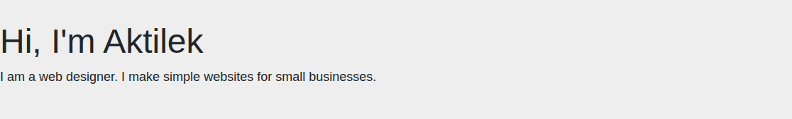

Tablet:

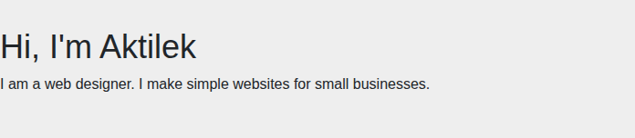

Mobile:

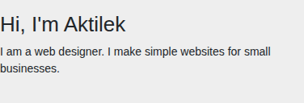

### Task 1. Responsive Layout with Media Queries

Three boxes, only CSS (no Bootstrap). `.boxes` is flex with `flex-wrap: wrap`. The width of `.box` changes: 1/3 on desktop, 1/2 on tablet, 100% on mobile.

```css
.boxes {
    display: flex;
    flex-wrap: wrap;
    gap: 10px;
}

.box { width: calc(33.33% - 7px); }

@media (max-width: 992px) {
    .box { width: calc(50% - 5px); }
}

@media (max-width: 576px) {
    .box { width: 100%; }
}
```

Desktop:

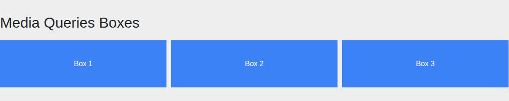

Tablet:

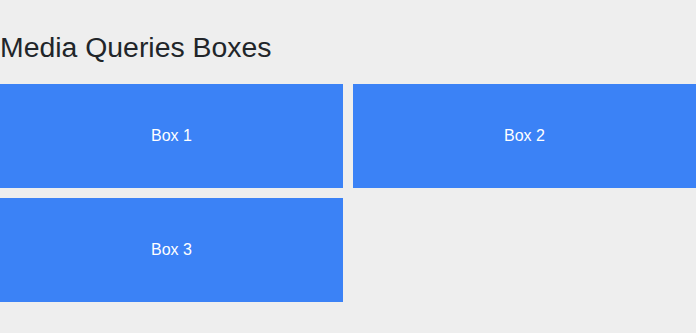

Mobile:

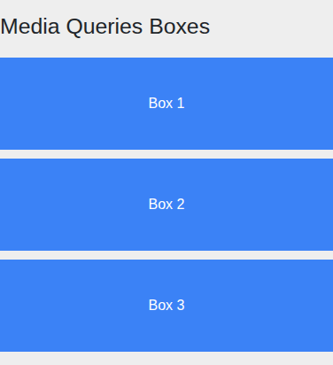

---

## Part 2. Bootstrap Grid System

### Task 2. Bootstrap Responsive Columns

Bootstrap has 12 columns. Each column has three classes:
- `col-12` — mobile: 12 of 12, all columns stacked
- `col-md-6` — tablet: 6 of 12, two columns in the first row, one in the second
- `col-lg-4` — desktop: 4 of 12, three equal columns

```html
<div class="row">
    <div class="col-12 col-md-6 col-lg-4">Column 1</div>
    <div class="col-12 col-md-6 col-lg-4">Column 2</div>
    <div class="col-12 col-md-6 col-lg-4">Column 3</div>
</div>
```

Desktop:

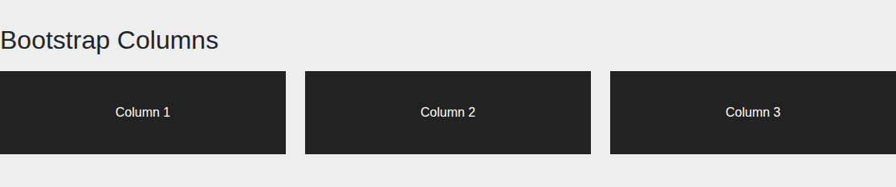

Tablet:

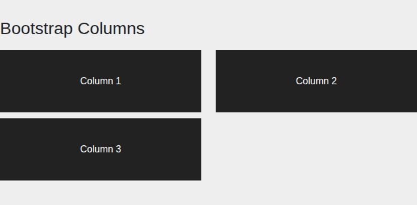

Mobile:

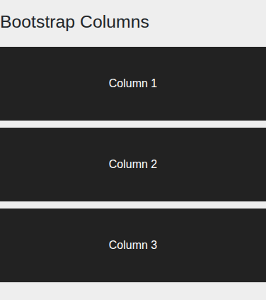

### Task 3. Bootstrap Navigation Bar

The navbar uses Bootstrap classes. The logo (`navbar-brand`) is on the left, the links are on the right (`ms-auto`). `navbar-expand-md` means: on small screens the links are hidden and a hamburger button (`navbar-toggler`) appears. The menu opens with `data-bs-toggle="collapse"`.

```html
<nav class="navbar navbar-expand-md navbar-dark bg-dark">
    <a class="navbar-brand" href="#">Aktilek</a>
    <button class="navbar-toggler" data-bs-toggle="collapse" data-bs-target="#menu">
        <span class="navbar-toggler-icon"></span>
    </button>
    <div class="collapse navbar-collapse" id="menu">
        <ul class="navbar-nav ms-auto"> ... </ul>
    </div>
</nav>
```

Desktop:


Mobile (hamburger menu opened):

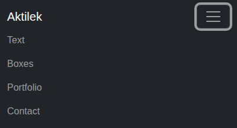

---

## Part 3. Combined Project

### Task 4. Responsive Portfolio Page

1. Header with the Bootstrap navbar.
2. Main section with two parts: projects on the left (`col-lg-8`, cards in a grid `col-md-6`) and a sidebar with personal info and contacts on the right (`col-lg-4`). On tablet and mobile the sidebar goes under the projects.
3. Footer across the bottom.

Custom media queries change font sizes, spacing (`section` padding) and visibility (`.hide-mobile` is hidden on mobile).

```css
@media (max-width: 576px) {
    section { padding: 15px 0; }
    .hide-mobile { display: none; }
}
```

Desktop:

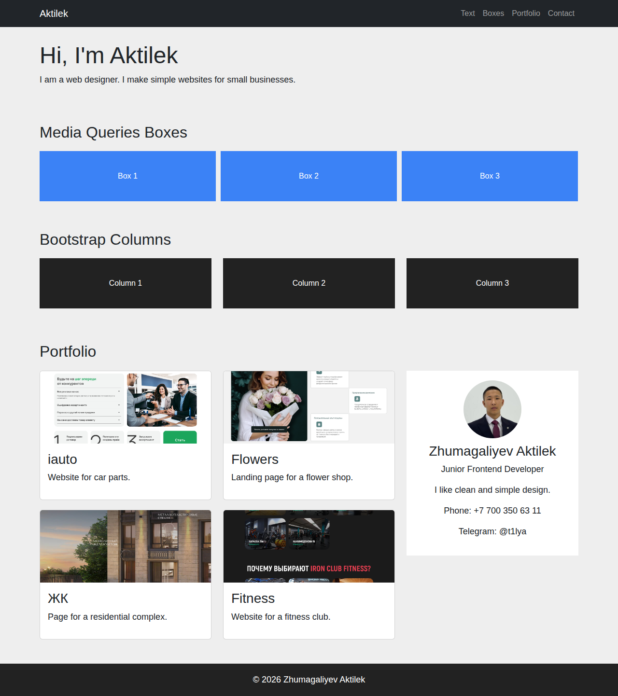

Mobile:


---

## Summary

First I made a heading and a paragraph and changed their font size with media queries. Then I made three boxes with Flexbox and changed their width with media queries for desktop, tablet and mobile. After that I connected Bootstrap and made three columns with the 12-column grid. Then I made a Bootstrap navbar that turns into a hamburger menu on small screens. In the end I made a portfolio section: projects on the left, a sidebar on the right and a footer, using Bootstrap grid and my own media queries.
