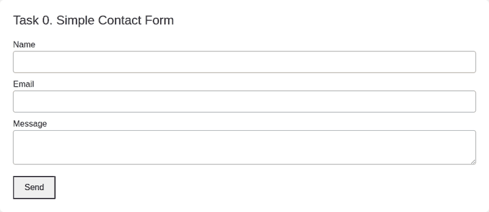
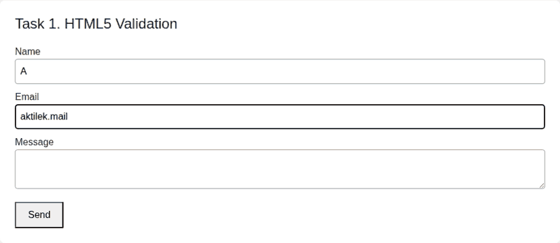
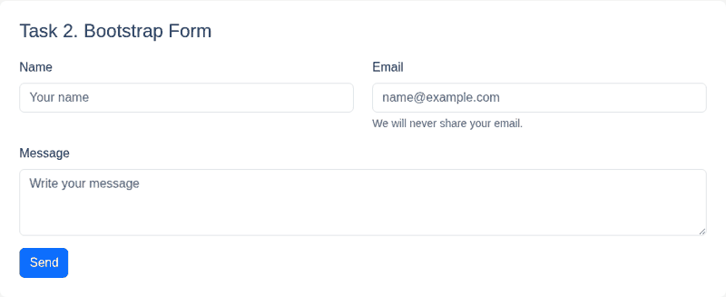
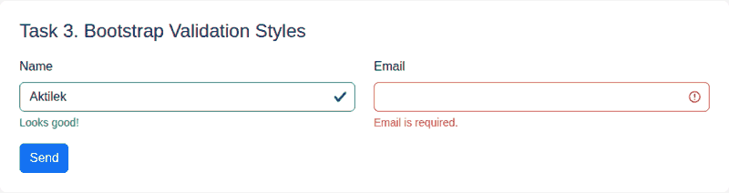
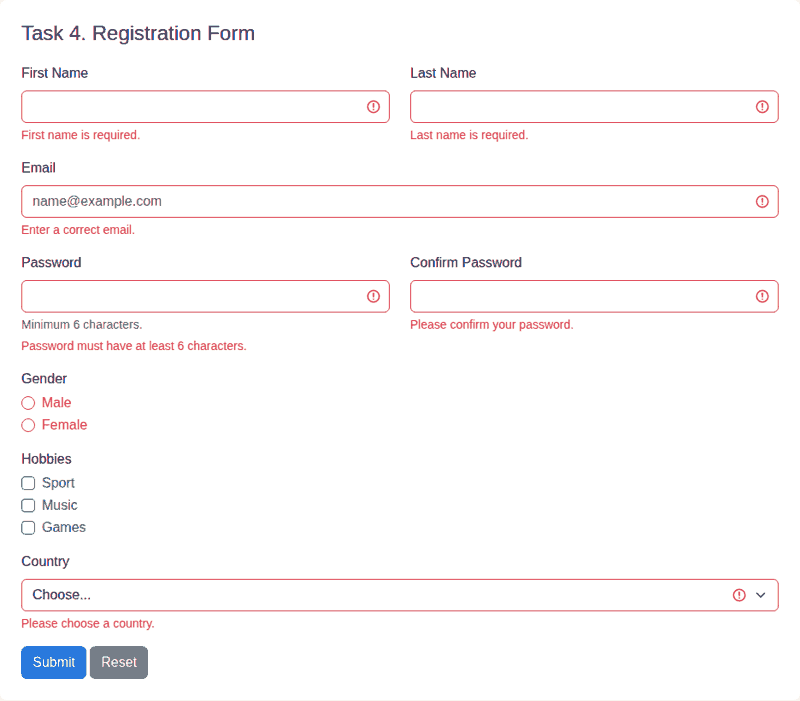
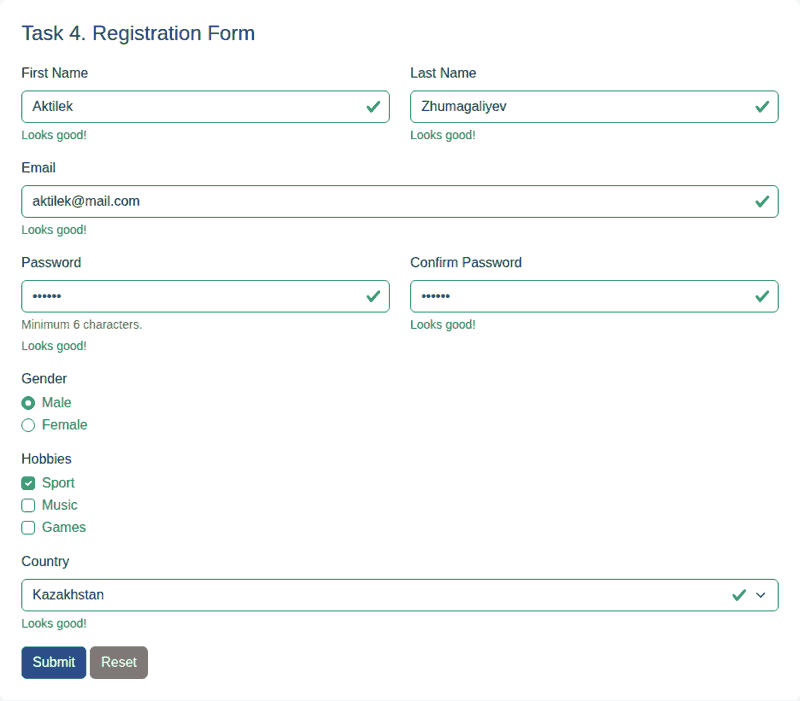
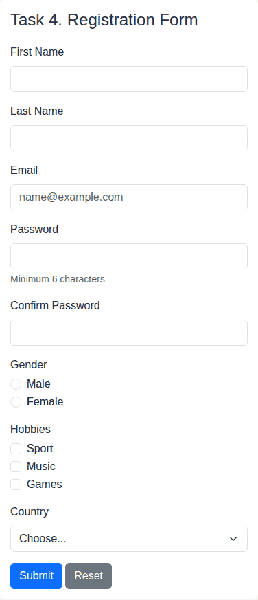

# Assignment #4. Forms and Validation

**Name:** Zhumagaliyev Aktilek
**Group:** IT-2503

Files:
- `index.html` — the page (all tasks)
- `styles.css` — my styles
- Bootstrap 5.3 is connected from CDN

---

## Part 1. Basic HTML Forms

### Task 0. Simple Contact Form

A simple form with Name (`type="text"`), Email (`type="email"`), Message (`<textarea>`) and a Submit button. Every field has a `<label>`. The `for` attribute of the label is the same as the `id` of the input, so a click on the label puts the cursor in the field.

```html
<label for="name0">Name</label>
<input type="text" id="name0">
```



### Task 1. Form with HTML5 Validation

I added built-in validation attributes:
- `required` — the field can not be empty,
- `type="email"` — the browser checks that the email has `@`,
- `minlength="2"` and `maxlength="30"` — length of the name,
- `maxlength="200"` — length of the message.

```html
<input type="text" id="name1" required minlength="2" maxlength="30">
<input type="email" id="email1" required>
<textarea id="message1" required maxlength="200"></textarea>
```

When I press Send with wrong data, the browser does not send the form and shows a message, for example:
- Name "A": *Please lengthen this text to 2 characters or more.*
- Email "aktilek.mail": *Please include an '@' in the email address.*
- Empty message: *Please fill out this field.*



---

## Part 2. Bootstrap Forms

### Task 2. Bootstrap Form Styling

The same form with Bootstrap classes:
- `form-label` for labels, `form-control` for inputs,
- `row` and `col-12 col-md-6` — Name and Email are in one row on a computer and one under another on a phone,
- `placeholder` — grey hint inside the field,
- `form-text` — helper text under the email field.

```html
<div class="col-12 col-md-6 mb-3">
    <label for="email2" class="form-label">Email</label>
    <input type="email" class="form-control" id="email2" placeholder="name@example.com">
    <div class="form-text">We will never share your email.</div>
</div>
```



### Task 3. Bootstrap Validation Styles

`is-valid` makes the field green, `is-invalid` makes it red. The message is in `valid-feedback` or `invalid-feedback` under the input. Bootstrap shows it only when the input has the right class.

```html
<input type="text" class="form-control is-valid" value="Aktilek">
<div class="valid-feedback">Looks good!</div>

<input type="email" class="form-control is-invalid">
<div class="invalid-feedback">Email is required.</div>
```



---

## Part 3. Advanced Form Project

### Task 4. Registration Form

The form has First Name, Last Name, Email, Password, Confirm Password, Gender (radio), Hobbies (checkboxes), Country (select), Submit and Reset buttons.

- **Responsive:** Bootstrap grid `col-12 col-md-6` — two fields in a row on a computer, one on a phone.
- **HTML5 validation:** `required` on fields, `type="email"`, password `minlength="6"`.
- **Bootstrap validation:** the form has `class="needs-validation"` and `novalidate` (the browser does not show its own messages). After pressing Submit, a small script adds the class `was-validated` to the form. Then Bootstrap shows wrong fields in red with `invalid-feedback` and correct fields in green with `valid-feedback`.

```html
<form class="needs-validation" novalidate>
    <input type="password" class="form-control" id="password" minlength="6" required>
    <div class="invalid-feedback">Password must have at least 6 characters.</div>
    ...
</form>
```

```js
const form = document.querySelector('.needs-validation');

form.addEventListener('submit', function (event) {
    event.preventDefault();
    form.classList.add('was-validated');
});

form.addEventListener('reset', function () {
    form.classList.remove('was-validated');
});
```

Empty form after pressing Submit:



Correct data:



Mobile:



---

## Summary

First I made a simple contact form with labels. Then I added HTML5 validation attributes and checked how the browser stops the form with wrong data. After that I made the same form with Bootstrap classes and grid, added placeholders and helper text. Then I showed Bootstrap validation styles with `is-valid` and `is-invalid`. In the end I made a responsive registration form with HTML5 validation and Bootstrap validation feedback.
