# Assignment #6. jQuery (Selectors, Effects, Animations)

**Name:** Zhumagaliyev Aktilek
**Group:** IT-2503

Files:
- `index.html` — the page
- `styles.css` — styles
- `script.js` — jQuery code
- `images/` — my photos

---

## Part 1. Getting Started with jQuery

### Task 0. Setup

jQuery is connected from the CDN before my script. All code is inside `$(document).ready()`, so it runs after the page is loaded. In the console it prints "jQuery is ready!".

```html
<script src="https://code.jquery.com/jquery-3.7.1.min.js"></script>
<script src="script.js"></script>
```

```js
$(document).ready(function () {
    console.log("jQuery is ready!");
});
```

### Task 1. Selectors & CSS

The profile section has my name, a headline, a short introduction and the title "Welcome to My Portfolio". I used a tag selector (`h1`), an ID selector (`#headline`) and a class selector (`.intro`) with `.css()`. The "Change Greeting" button changes the text with `.text()` and `.html()`. Two buttons switch between light and dark theme.

```js
$("h1").css("color", "#3a6ea5");
$("#headline").css("font-style", "italic");
$(".intro").css("font-size", "18px");

$("#greetBtn").click(function () {
    $("#headline").text("Thank you for visiting my page!");
    $("#welcome").html("Welcome to <b>My jQuery Portfolio</b>");
});

$("#darkBtn").click(function () {
    $("body").css({ "background-color": "#1e1e1e", "color": "#eee" });
    $("section").css("background-color", "#2d2d2d");
});
```

After "Change Greeting":

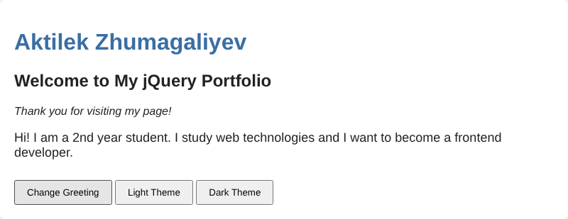

Dark theme:

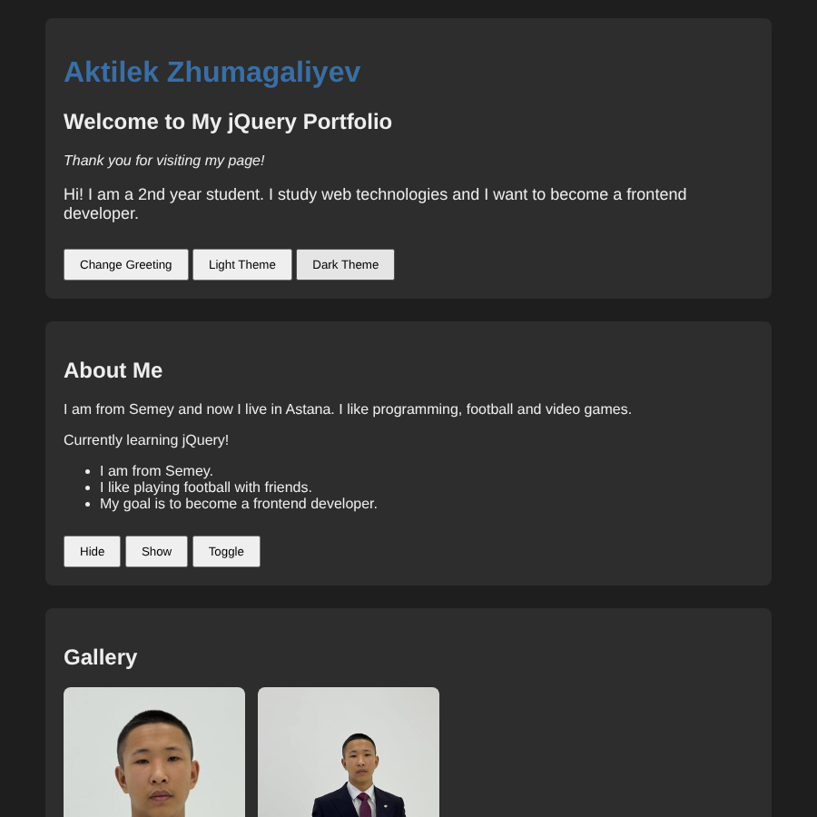

---

## Part 2. jQuery Effects

### Task 2. Visibility Methods

The "About Me" section has a short biography, a status message and fun facts. The buttons Hide, Show and Toggle use `.hide()`, `.show()` and `.toggle()` on the status and the fun facts.

```js
$("#hideBtn").click(function () {
    $("#status, #facts").hide();
});
```

Shown:

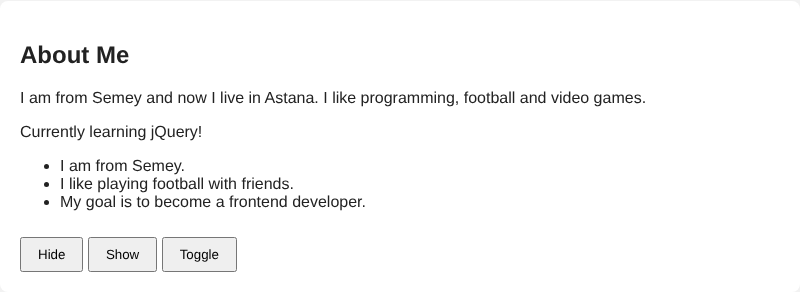

Hidden:

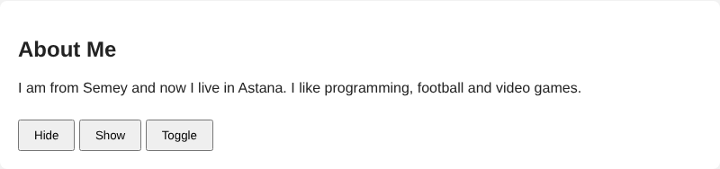

### Task 3. Fade Methods

Two photos in the gallery. The buttons use `.fadeIn()`, `.fadeOut()` and `.fadeToggle()`.

```js
$("#fadeOutBtn").click(function () {
    $(".images img").fadeOut();
});
```

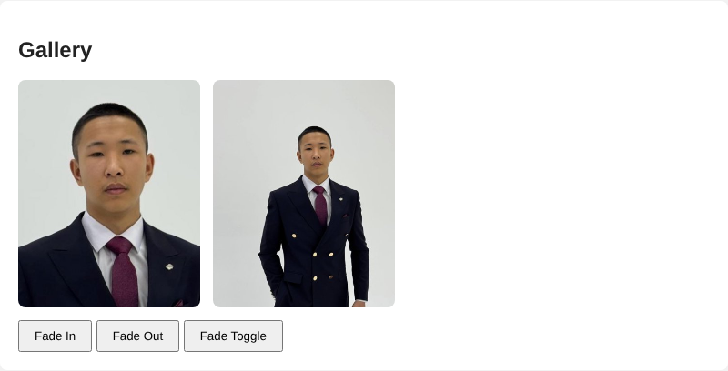

After Fade Out:

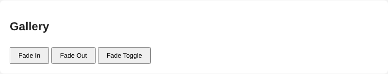

### Task 4. Slide Methods

Three clickable headings: music, movie and subject. Each panel is hidden at the start. A click on a heading opens or closes the next panel with `.slideToggle()`. "Open All" uses `.slideDown()` and "Close All" uses `.slideUp()`.

```js
$(".panel-title").click(function () {
    $(this).next().slideToggle();
});
```

Music and Movie panels are open:

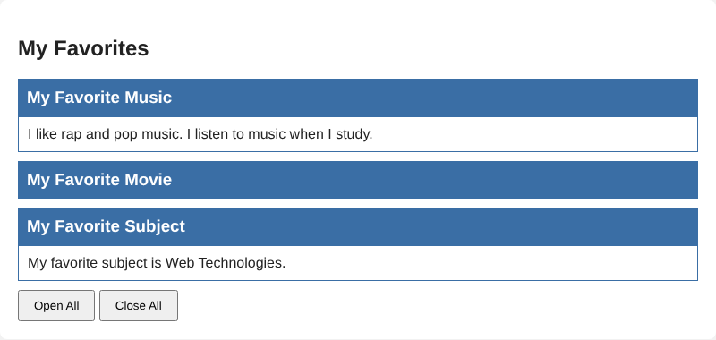

---

## Part 3. DOM Manipulation with jQuery

### Task 5. Add & Remove Elements

The list starts with 4 skills. "Add Skill" adds to the end with `.append()`, "Prepend Skill" adds to the start with `.prepend()`, "Remove Skill" deletes the last skill with `.remove()`. If the input is empty, the skill is not added and a message is shown.

```js
$("#addBtn").click(function () {
    let skill = $("#skillInput").val().trim();
    if (skill === "") {
        $("#skillMsg").text("Please enter a skill.");
        return;
    }
    $("#skillList").append("<li>" + skill + "</li>");
    $("#skillInput").val("");
});
```

Added "Git" with Add, "C#" with Prepend, then pressed Add with an empty input:

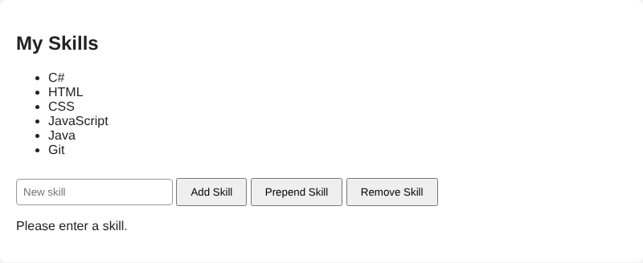

### Task 6. Modifying Attributes

The link goes to my GitHub. The "Change Link" button changes `href` with `.attr()` to my Web1 repository.

```js
$("#socialLink").attr("href", "https://github.com/Tilya1/Web1");
```

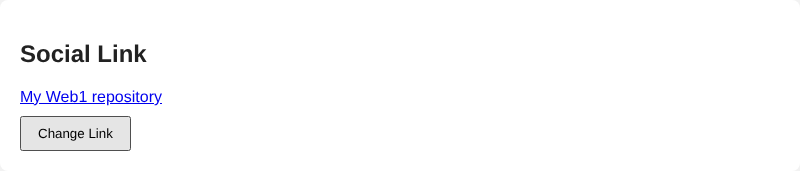

### Task 7. Form Interaction

When the user types, the text is shown below the form. `.val()` takes the value and `.text()` shows it.

```js
$("#nameInput").on("input", function () {
    $("#showName").text($(this).val());
});
```

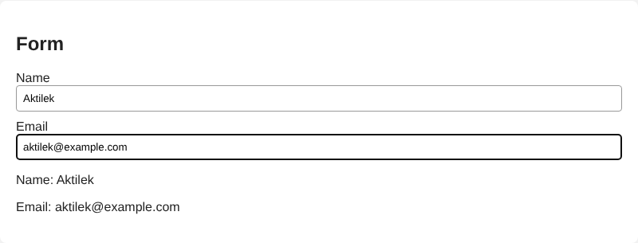

---

## Part 4. Animations

### Task 8. Basic Animation

Three skill bars start with width 0. "Animate My Skills" makes them wider with `.animate()`: HTML 90%, CSS 75%, JavaScript 50%. The second click makes them 0 again. The variable `barsOpen` remembers the state.

```js
$("#animateBtn").click(function () {
    if (barsOpen === false) {
        $("#barHtml").animate({ width: "90%" }, 1000);
        $("#barCss").animate({ width: "75%" }, 1000);
        $("#barJs").animate({ width: "50%" }, 1000);
        barsOpen = true;
    } else {
        $(".bar").animate({ width: "0%" }, 1000);
        barsOpen = false;
    }
});
```

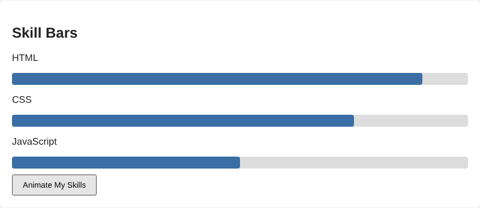

---

## Summary

First I connected jQuery from a CDN and checked it with `$(document).ready()` and the console. Then I made the profile section and used tag, ID and class selectors with `.css()`, `.text()` and `.html()`, and added light and dark themes. After that I added effects: hide/show/toggle for the About Me section, fade for the gallery and slide for the favorites panels. Then I worked with the DOM: adding and removing skills, changing a link with `.attr()` and showing form input live. In the end I made skill bars that grow and go back to zero with `.animate()`.
