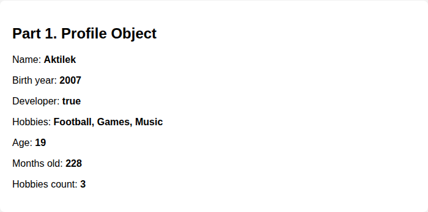
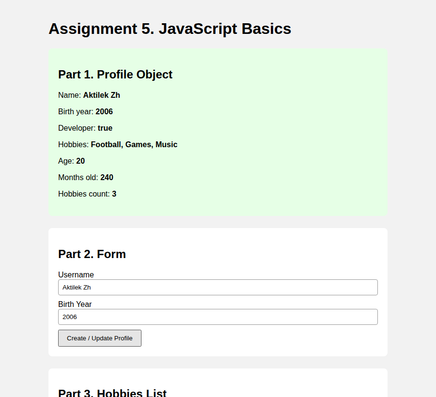
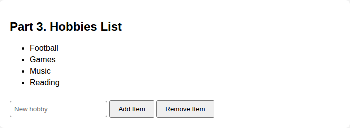

# Assignment #5. JavaScript Basics (DOM Manipulation & Events)

**Name:** Zhumagaliyev Aktilek
**Group:** IT-2503

Files:
- `index.html` — the page
- `styles.css` — styles
- `script.js` — JavaScript code

---

## Part 1. Profile Object, Data Types & Arithmetic

### Task 1. The Personal Info Object

I made a `const` object `userProfile` with different data types: string, number, boolean and array.

```js
const userProfile = {
    name: "Aktilek",
    birthYear: 2007,
    isDeveloper: true,
    hobbies: ["Football", "Games", "Music"]
};
```

### Task 2. Arithmetic Calculations

The age is calculated from the current year minus the birth year. Then I calculate months (age * 12) and the number of hobbies (`length` of the array). The values are shown on the page and in the console.

```js
const currentYear = new Date().getFullYear();
const age = currentYear - userProfile.birthYear;
const months = age * 12;
const hobbiesCount = userProfile.hobbies.length;
```



---

## Part 2. Form Input & Event Responses

### Task 3. HTML Form Setup

A form with Username, Birth Year and the "Create / Update Profile" button.

```html
<form id="profileForm">
    <label for="username">Username</label>
    <input type="text" id="username" required>

    <label for="birthYear">Birth Year</label>
    <input type="number" id="birthYear" min="1900" max="2026" required>

    <button type="submit">Create / Update Profile</button>
</form>
```


### Task 4. Event Listener

I added a `submit` event listener to the form. `preventDefault()` stops the page from reloading. The script takes the values from the inputs, updates `userProfile` and shows the new data. The background of Part 1 becomes green after the update.

```js
form.addEventListener("submit", function (event) {
    event.preventDefault();

    userProfile.name = document.getElementById("username").value;
    userProfile.birthYear = Number(document.getElementById("birthYear").value);

    showProfile();
    document.getElementById("part1").style.backgroundColor = "#e6ffe6";
});
```



---

## Part 3. DOM List Manipulation

### Task 5. Creating & Removing Elements

There is a `<ul>` with my hobbies. "Add Item" creates a new `<li>` with `createElement` and adds it with `appendChild`. "Remove Item" deletes the last `<li>` with `lastElementChild.remove()`. The hobbies array and the hobbies count are updated too.

```js
const li = document.createElement("li");
li.textContent = newItem.value;
list.appendChild(li);
```

```js
list.lastElementChild.remove();
```

Added "Reading":



Removed two items:


---

## Summary

First I made the `userProfile` object with different data types. Then I calculated the age, months and hobbies count with arithmetic operators and showed them on the page and in the console. After that I made a form and added a submit event listener that updates the object with the user input. In the end I made a hobbies list where the user can add a new item and remove the last item.
